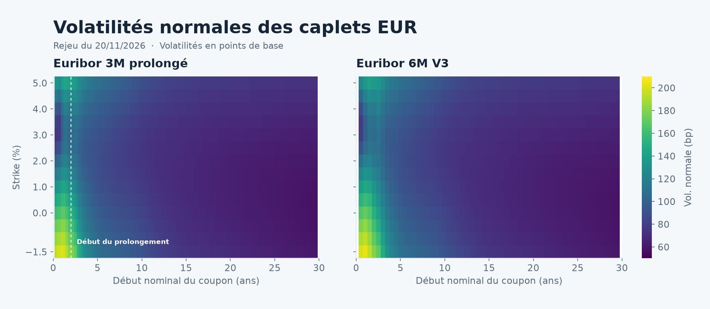
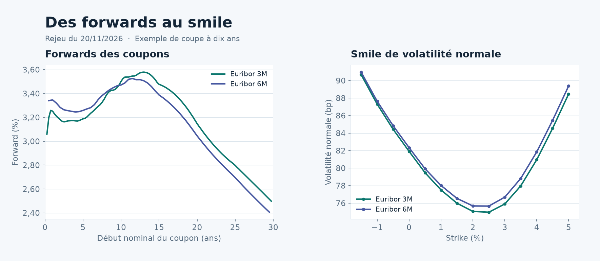
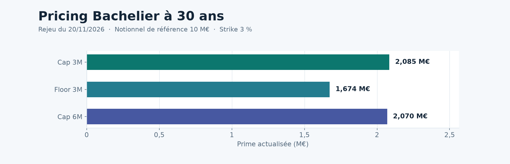

# Surfaces de caplets à 30 ans

**V3 + candidat 3M · Euribor 3M et 6M · Pricing Bachelier**

Une cotation de cap donne une volatilité pour un contrat qui contient plusieurs coupons. Pour valoriser un contrat à dates ou strikes différents, il faut retrouver la volatilité de chaque coupon. Ce projet part d’un classeur de marché et reconstruit les courbes, les forwards et la surface de volatilité que le pricer utilise ensuite coupon par coupon.



*Rejeu historique du 20 novembre 2026. Volatilités normales en points de base.*

## Exemple réel

Les surfaces du rejeu sont évaluées sur 14 strikes de −1,5 % à 5 %. Le moteur reconstruit la courbe d’actualisation €STR et les deux courbes de projection Euribor. Chaque case du graphique provient d’un coupon et d’un strike évalués par le moteur.

| Surface | Fixings de la grille | Volatilités calculées | Dernière fin de coupon |
| --- | ---: | ---: | --- |
| Euribor 3M | 119 | 1 666 | 24 novembre 2056 |
| Euribor 6M | 59 | 826 | 24 novembre 2056 |



## Du classeur au prix

1. **Courbes et forwards.** `ESTR` donne les cotations d’actualisation. `EUR3` et `EUR6` alimentent les courbes qui projettent chaque coupon. Les fixings observés chargés à la date de marché servent à la calibration et au traitement des coupons déjà fixés.
2. **Stripping.** Le moteur transforme les vols de caps de `VOL CAP` en primes, puis isole la contribution des caplets. Le **candidat 3M** partage une courbe de variance entre les premiers caplets et alloue ensuite les primes résiduelles. Le **6M V3** conserve son ajustement quadratique dans le temps et utilise le 3M pour le raccord court.
3. **Prolongement à 30 ans.** Après la dernière échéance native du 3M, le moteur transfère le smile 6M en tenant compte des forwards et de la composition de deux périodes 3M. La corrélation de transfert vaut 1 par défaut et peut servir de paramètre de scénario.
4. **Pricing.** Le moteur applique Bachelier au strike et aux dates de chaque coupon, puis additionne les valeurs actualisées. Un coupon déjà fixé est valorisé à partir du taux constaté.

Le stripping par blocs et le lissage en maturité reprennent des idées décrites par Hagan et Konikov. Le candidat 3M, le raccord entre indices et le prolongement sont propres au moteur. [Explication, équations et liens vers le code](docs/du-classeur-au-prix.md)

## Rejouer le calcul

Python 3.12 ou ultérieur est nécessaire. Sous Windows, `Tracer les surfaces.cmd` installe les dépendances au premier lancement et ouvre un sélecteur de fichier.

À la racine du dépôt, créer un environnement Python, installer les dépendances puis indiquer le classeur et le dossier d’historiques.

```sh
python -m venv .venv
source .venv/bin/activate
python -m pip install -r requirements.txt
python reproduire.py "local/20261120 - md.xlsx" --hors-ligne --ouvrir
```

Sous PowerShell, utiliser `.venv\Scripts\Activate.ps1` ou le lanceur. Placer le classeur dans `local/` et les historiques dans `local/fixings/`. Utiliser `--fixings-dir` pour choisir un autre emplacement. La date est lue dans le nom du fichier ou renseignée avec `--date AAAA-MM-JJ`. Les formats des quatre feuilles et des historiques sont décrits dans [Entrées et conventions](docs/entrees.md).

Le calcul prend plusieurs minutes. Dans `resultats/`, `rapport.html` permet d’explorer les surfaces en 3D et le smile de chaque fixing. La même exécution produit les grilles CSV et JSON ainsi que les diagnostics de calibration.

## Essayer le pricing

Ajouter `--pricing examples/pricing.json` à la commande pour rejouer trois contrats à 30 ans. Les exemples utilisent un notionnel de 10 M€ et un strike de 3 %. Le fichier généré `pricing.json` donne le détail des valeurs actuelles et des fixings coupon par coupon.



Dans ce rejeu, les coupons fixés le jour de marché ont utilisé leur fixing observé et le cap et le floor 3M ont satisfait la parité. Le contrôle de repricing du moteur signale des écarts hors tolérance sur certains floors natifs 3M. Le prolongement reste une hypothèse de modélisation expérimentale.

## Lire le code

| Si tu veux comprendre… | Commencer ici |
| --- | --- |
| Ce qui se passe après le choix du classeur | [reproduire.py](reproduire.py) |
| Comment les courbes produisent un forward | [moteur/services/latest_normal_coupon.py](moteur/services/latest_normal_coupon.py) |
| Comment le candidat 3M est calibré | [moteur/services/latest_normal_candidate.py](moteur/services/latest_normal_candidate.py) |
| Comment le 3M est prolongé et partagé avec le pricer | [moteur/services/latest_normal_extension.py](moteur/services/latest_normal_extension.py) |

Les 75 modules sous `moteur/` proviennent du kit V3 + candidat 3M. Le guide [Du classeur au prix](docs/du-classeur-au-prix.md) les aborde par étape. Les [commandes de vérification](docs/reproductibilite.md) permettent de tester les fixings et de régénérer les figures.
