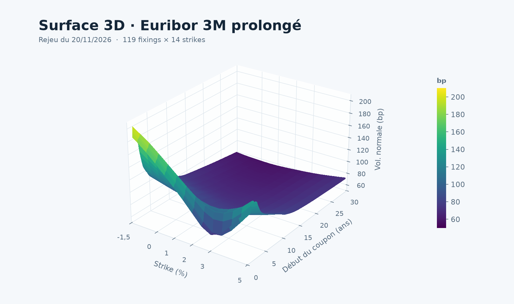
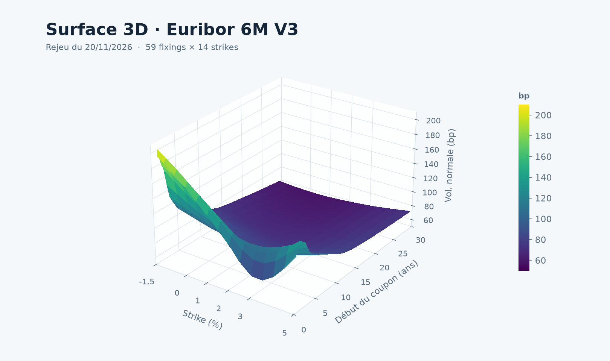
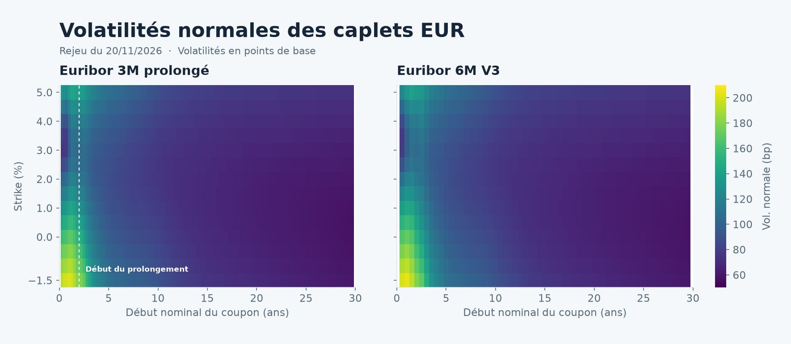
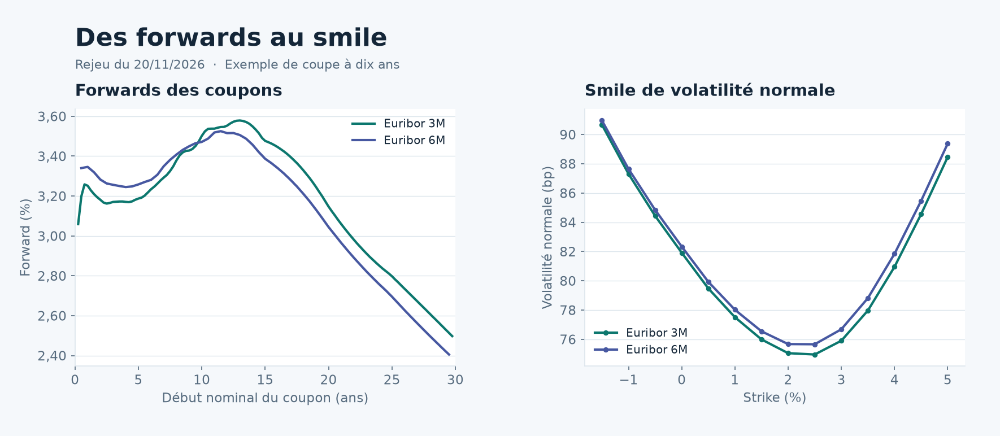
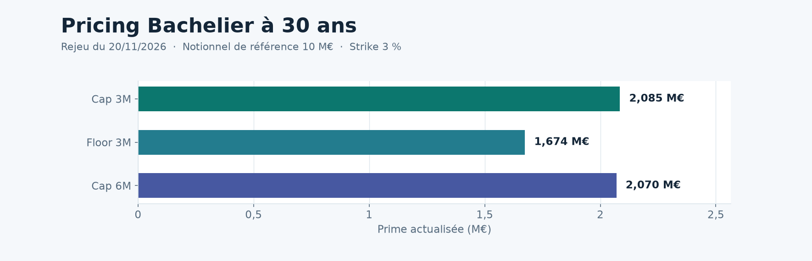

# Visuels du rejeu du 20 novembre 2026

## Surfaces Euribor à 30 ans

**[Explorer les surfaces en 3D](https://tpmhsn.github.io/caplet-volatility-surface/)**

Choisis Euribor 3M ou 6M. Glisse sur le graphique pour le tourner et utilise la molette pour zoomer.

### Euribor 3M prolongé

### Euribor 6M V3

## Cartes de volatilité

## Forwards et smile

## Pricing Bachelier

